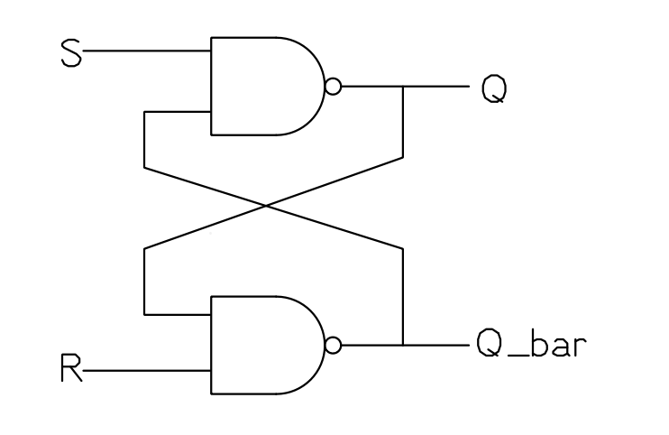
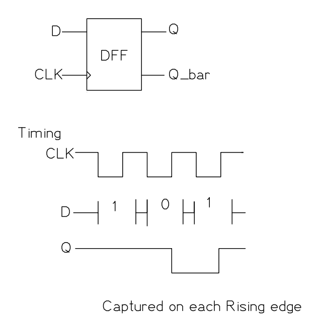
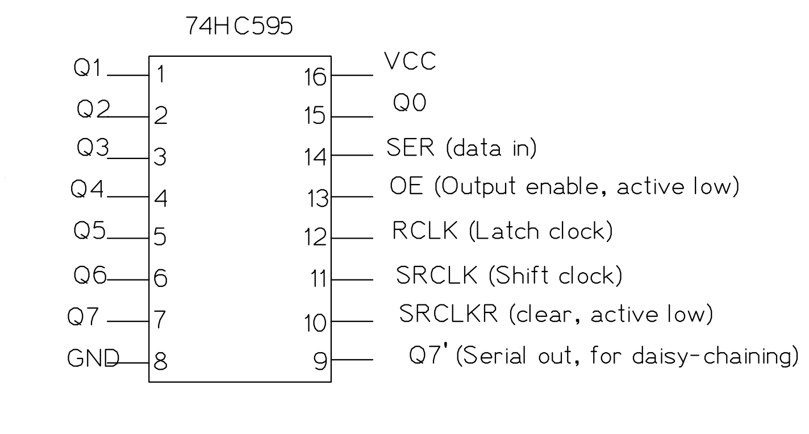

import TawkWidget from '../../../../components/TawkWidget.astro';
import UniversalContentContributors from '../../../../components/UniversalContentContributors.astro';
import InArticleAd from '../../../../components/InArticleAd.astro';
import Copyright from '../../../../components/Copyright.astro';
import BionicText from '../../../../components/BionicText.astro';
import TailwindWrapper from '../../../../components/TailwindWrapper.jsx';
import { Tabs, TabItem } from '@astrojs/starlight/components';
import { Card, CardGrid, Badge, Steps, LinkButton, FileTree } from '@astrojs/starlight/components';

<UniversalContentContributors 
  contributors={frontmatter.contributors}
/>


import DigitalElectronicsComments from '../../../../components/digital-electronics/DigitalElectronicsComments.astro';

A doorbell stops when you release the button. A lift call button stays lit after you take your finger away. The second circuit remembers, and gates alone cannot do that: their output depends only on the inputs at this moment. A traffic light must remember which colour it shows. A serial link must hold the bits that arrive one at a time until the byte is complete. This lesson builds the flip-flop, a memory for one bit, and uses it to drive eight outputs from three pins. #FlipFlops #ShiftRegisters #SequentialLogic

## From Combinational to Sequential

A circuit with memory is called sequential. The difference:

| Property | Combinational | Sequential |
|----------|--------------|-----------|
| Memory | None | Stores state |
| Output depends on | Current inputs only | Current inputs AND stored state |
| Clock | Not required | Usually clocked |
| Examples | Gates, mux, decoder, adder | Flip-flops, registers, counters |

A sequential circuit is combinational logic with two additions: feedback (an output connected back to an input) and usually a clock, a steady square wave that tells every part of the circuit when to act.

## The SR Latch

<InArticleAd />


### Concept

The SR (Set-Reset) latch is the simplest memory element. It stores one bit and has two inputs:

- **S (Set):** sets the output to 1
- **R (Reset):** sets the output to 0

### SR Latch from NAND Gates

Two cross-coupled NAND gates form an SR latch. The output of each gate feeds back to an input of the other, so each gate holds the other in its state after the input signal has gone. That loop is the memory.



In this NAND version the inputs are active-low: an input acts when it is 0 and rests at 1.

**Truth table (active-low inputs):**

| S | R | Q (next) | $\overline{Q}$ (next) | Action |
|---|---|----------|-----------|--------|
| 1 | 1 | Q (hold) | $\overline{Q}$ (hold) | No change |
| 0 | 1 | 1 | 0 | Set |
| 1 | 0 | 0 | 1 | Reset |
| 0 | 0 | Invalid | Invalid | Forbidden |

The first row is the memory: with both inputs at rest, Q stays as the last set or reset left it. The "forbidden" row asks for set and reset together. Both outputs go high, and when the inputs are released the latch may take either state.

### SR Latch from NOR Gates

Two cross-coupled NOR gates also form an SR latch, with active-high inputs (an input acts when it is 1):

| S | R | Q (next) | Action |
|---|---|----------|--------|
| 0 | 0 | Q (hold) | No change |
| 1 | 0 | 1 | Set |
| 0 | 1 | 0 | Reset |
| 1 | 1 | Invalid | Forbidden |

## The D Flip-Flop

<InArticleAd />


### Why D Flip-Flops?

The SR latch has two problems. One is the forbidden state. The other is that it has no clock: it changes the instant an input changes, so a noise pulse is stored as if it were data. The D (Data) flip-flop solves both. It has one data input, and it stores only at a moment the clock chooses:

- **D (Data) input:** the value to store
- **CLK (Clock) input:** when to store it
- **Q output:** the stored value
- **$\overline{Q}$ output:** the complement of the stored value

### How It Works



A D flip-flop works as a camera does. On the rising edge of the clock (the moment CLK goes from 0 to 1), it takes a picture of D and shows that picture at Q. At all other times Q keeps the picture, whatever D does.

**Characteristic table:**

| CLK Edge | D | Q (next) |
|----------|---|----------|
| Rising | 0 | 0 |
| Rising | 1 | 1 |
| No edge | X | Q (hold) |

A register inside a processor does the same: it captures data at a clock edge and holds it steady until the next capture.

### Timing Concepts

A picture is blurred if the subject moves while the shutter is open. In the same way, D must not change in a short window around the clock edge:

- **Setup time ($t_{su}$):** D must be stable for at least this long *before* the clock edge.
- **Hold time ($t_h$):** D must stay stable for at least this long *after* the clock edge.

If D changes inside the window, Q may hover between 0 and 1 for a while and then fall to either value. This is called metastability. For the 74HC74 (dual D flip-flop), the typical setup time is about 14 ns and the hold time about 3 ns at 5V.

A signal not tied to the clock (a button, a sensor, a chip with its own clock) will sooner or later change inside that window. The cure is two D flip-flops in a row on the same clock: the first may go metastable, and it has a full clock period to settle before the second takes its picture. Microcontrollers have this synchroniser behind their input pins; logic you build yourself needs its own.

### Building a D Flip-Flop from NAND Gates

A rising-edge D flip-flop can be built from six NAND gates, arranged as three latches of the kind shown above. To use one you need only its behaviour: data is captured on the clock edge.

## The JK Flip-Flop

<InArticleAd />


### Concept

The JK flip-flop is a clocked set-reset flip-flop (J sets, K resets) that puts the forbidden input pair to use. When both J and K are 1 on a clock edge, the output toggles: it changes to the opposite of what it was.

**Characteristic table:**

| J | K | Q (next) | Action |
|---|---|----------|--------|
| 0 | 0 | Q | Hold |
| 0 | 1 | 0 | Reset |
| 1 | 0 | 1 | Set |
| 1 | 1 | $\overline{Q}$ | Toggle |

The toggle mode ($J = K = 1$) is what counters are built from.

### JK vs D

In modern designs, D flip-flops are far more common than JK flip-flops because:

1. D flip-flops are simpler (fewer gates)
2. A D flip-flop toggles too, if you feed its inverted output back to its input ($D = \overline{Q}$)
3. Programmable logic chips (FPGAs) and their design tools use D flip-flops only

You will rarely place a JK flip-flop in a new design, but its toggle behaviour explains how counters work.

## Shift Registers

<InArticleAd />


### Concept

One pin can send only one bit at a time, but eight LEDs need eight bits at once. A shift register collects bits that arrive one after another and presents them side by side.

It is a chain of D flip-flops in which the output of each connects to the input of the next. Think of people in a line passing buckets: on each clock edge, every flip-flop hands its bit to its neighbour and takes a new one from the other side.

### 4-Bit Serial-In, Parallel-Out (SIPO) Shift Register

```text
           ┌──────┐   ┌──────┐   ┌──────┐   ┌──────┐
 Data In ─►│ FF 0 ├──►│ FF 1 ├──►│ FF 2 ├──►│ FF 3 │
           └──┬───┘   └──┬───┘   └──┬───┘   └──┬───┘
              │          │          │          │
              Q0         Q1         Q2         Q3
        (all four share one clock)
```

On each clock pulse the new bit enters at Q0 and every older bit moves one place toward Q3:

| Clock Pulse | Data In | Q3 | Q2 | Q1 | Q0 |
|------------|---------|----|----|----|----|
| Initial | - | 0 | 0 | 0 | 0 |
| 1 | 1 | 0 | 0 | 0 | 1 |
| 2 | 0 | 0 | 0 | 1 | 0 |
| 3 | 1 | 0 | 1 | 0 | 1 |
| 4 | 1 | 1 | 0 | 1 | 1 |

After 4 clock pulses, the serial data `1011` is in the register and can be read on all four outputs at once. The first bit sent is now at Q3.

### Types of Shift Registers

The four letters say how data enters and leaves: S for serial (one bit per clock) and P for parallel (all bits at once). SIPO is serial-in, parallel-out.

| Type | Serial Input | Parallel Input | Serial Output | Parallel Output |
|------|-------------|---------------|--------------|----------------|
| SIPO | Yes | No | No | Yes |
| PISO | No | Yes | Yes | No |
| SISO | Yes | No | Yes | No |
| PIPO | No | Yes | No | Yes |

The 74HC595 is a SIPO shift register with an output latch. The 74HC164 is a simpler SIPO without the latch.

## The 74HC595: Your Most Useful IC

<InArticleAd />


### Why the 74HC595 Matters

A small microcontroller (MCU) runs out of pins quickly. The 74HC595 gives 8 outputs for 3 pins. It is an 8-bit SIPO shift register followed by a second row of 8 flip-flops, the storage register, which drives the output pins. The 3 signals are:

- **SER (serial data in):** the bit to shift in
- **SRCLK (shift register clock):** shifts the data one position on each rising edge
- **RCLK (register clock, also called the latch clock):** copies the shift register into the storage register, and so to the output pins

### 74HC595 Pin Layout



*The drawing labels pin 10 as SRCLKR. Its usual name, used below, is SRCLR (shift register clear).*

**Key connections:**

| Pin | Name | Connect To |
|-----|------|-----------|
| 8 | GND | Ground |
| 16 | VCC | 5V |
| 10 | SRCLR | 5V (to disable clear) |
| 13 | OE | GND (to enable outputs permanently) |
| 14 | SER | MCU data pin |
| 11 | SRCLK | MCU clock pin |
| 12 | RCLK | MCU latch pin |
| 15, 1-7 | Q0-Q7 | LEDs (through 470 ohm resistors) |
| 9 | Q7' | SER of next 74HC595 (for daisy-chaining) |

### How Data Flows Through the 74HC595

<Steps>
1. **Set the data bit** on the SER pin (high or low).
2. **Pulse SRCLK** (low to high). The bit on SER shifts into position 0 of the internal shift register, and all existing bits shift one position toward Q7.
3. **Repeat** steps 1 and 2 for all 8 bits (MSB first is conventional).
4. **Pulse RCLK** (low to high). The 8 bits in the shift register are transferred to the output latch, and Q0 through Q7 update simultaneously.
</Steps>

The storage register is why step 4 exists. Without it, the LEDs would show every half-shifted pattern while the bits move through. With it, the outputs keep the old pattern during the 8 shifts and change to the new one in a single step.

## Practical: Drive 8 LEDs from 3 MCU Pins

<InArticleAd />


### Parts Needed

| Component | Quantity |
|-----------|----------|
| 74HC595 | 1 |
| LEDs | 8 |
| 470 ohm resistors | 8 |
| 10K ohm resistors | 3 |
| 100 nF capacitor | 1 |
| Breadboard | 1 |
| 5V power supply | 1 |
| Jumper wires | assorted |
| Push buttons (or an MCU) | 3 |

### Wiring

<Steps>
1. **Place the 74HC595** on the breadboard.

2. **Power:** pin 16 to 5V, pin 8 to GND, and the 100 nF capacitor from pin 16 to pin 8.

3. **Tie SRCLR (pin 10) to 5V** to prevent accidental clearing.

4. **Tie OE (pin 13) to GND** to enable all outputs.

5. **Connect 8 LEDs:** Each LED's anode connects to one output pin through a 470 ohm resistor. Each LED's cathode connects to GND. Q0 is pin 15, and Q1 to Q7 are pins 1 to 7. Not 220 ohm: a red LED would take about $(5 - 2)\,\text{V} / 220\,\Omega = 13.6$ mA, and eight about 109 mA through the one VCC pin, which is limited to 70 mA. With 470 ohm it is at most about 51 mA.

6. **Connect the three control signals** to push buttons (for manual testing) or to MCU pins. Each button connects its pin to 5V, with a 10K pull-down to GND. A button on SRCLK also bounces: one press can give several rising edges and shift the bit several places. An MCU gives clean edges.
</Steps>

### Manual Test Procedure

To display the pattern `10110011` (0xB3) on the LEDs:

<Steps>
1. Set SER high (bit 7 = 1). Pulse SRCLK.
2. Set SER low (bit 6 = 0). Pulse SRCLK.
3. Do the same for bits 5 down to 0: high, high, low, low, high, high, with one SRCLK pulse after each.
4. Pulse RCLK. All 8 LEDs update at once showing 10110011.
5. **Check it:** Q7 down to Q0 must read 1, 0, 1, 1, 0, 0, 1, 1. Shifted by one or more places: SRCLK saw extra edges (bounce). Reversed: the LEDs are in the wrong order, or the bits went LSB first.
</Steps>

### MCU Code (C, Any Platform)

```c
// Pin definitions (adapt to your MCU)
#define DATA_PIN   // SER (pin 14 on 595)
#define CLOCK_PIN  // SRCLK (pin 11 on 595)
#define LATCH_PIN  // RCLK (pin 12 on 595)

void shiftOut(uint8_t data) {
    // Shift out 8 bits, MSB first
    for (int8_t i = 7; i >= 0; i--) {
        // Set data pin to the current bit
        if (data & (1 << i)) {
            // Set DATA_PIN high
        } else {
            // Set DATA_PIN low
        }

        // Pulse the clock: low, then high
        // Set CLOCK_PIN low
        // Set CLOCK_PIN high
    }

    // Pulse the latch to transfer data to outputs
    // Set LATCH_PIN low
    // Set LATCH_PIN high
}
```

The same function, complete, for an ATmega328P (Arduino Uno or Nano; SER, SRCLK and RCLK on PB0, PB1, PB2, board pins D8 to D10):

```c
#include <avr/io.h>

#define SER   PB0
#define SRCLK PB1
#define RCLK  PB2

void shift_out_595(uint8_t data) {
    for (int8_t i = 7; i >= 0; i--) {            // MSB first
        if (data & (1 << i)) PORTB |= (1 << SER);
        else                 PORTB &= ~(1 << SER);
        PORTB |= (1 << SRCLK);                   // rising edge: shift
        PORTB &= ~(1 << SRCLK);
    }
    PORTB |= (1 << RCLK);                        // rising edge: show
    PORTB &= ~(1 << RCLK);
}

int main(void) {
    DDRB |= (1 << SER) | (1 << SRCLK) | (1 << RCLK);
    shift_out_595(0xB3);                         // Q7..Q0 = 1011 0011
    for (;;) { }
}
```

The LEDs must show the same 10110011 as the manual test. The Arduino `shiftOut()` function does the same shifting. So does the SPI peripheral, in hardware: SPI is the serial bus you meet with the bus interfaces later in this course.

### Daisy-Chaining for More Outputs

The drawing shows the circuit you built. At the bottom right is Q7', the pin through which bits leave the chip:

```text
  74HC595 driving 8 LEDs from 3 MCU pins

  MCU                  74HC595
  ┌──────┐            ┌───────────┐
  │      ├─ SER ─────►│14 SER   Q0├──[470R]── LED0
  │      │            │         Q1├──[470R]── LED1
  │      ├─ SRCLK ───►│11 SRCLK Q2├──[470R]── LED2
  │      │            │         Q3├──[470R]── LED3
  │      ├─ RCLK ────►│12 RCLK  Q4├──[470R]── LED4
  └──────┘            │         Q5├──[470R]── LED5
   3 pins      GND ───┤13 OE    Q6├──[470R]── LED6
   control     VCC ───┤10 CLR   Q7├──[470R]── LED7
   8 outputs          │           │
                      │16 VCC  Q7'├──► pin 9, to SER (14)
                      │ 8 GND     │    of the next 74HC595
                      └───────────┘
```

Q7' (pin 9) shows the bit in the last flip-flop of the shift register. Connect it to SER (pin 14) of a second 74HC595, and connect SRCLK and RCLK to both chips. Now shift out 16 bits, and both chips update together when you pulse RCLK.

You can add more chips in the same way. Three 74HC595s give 24 outputs from the same 3 MCU pins.

## Parallel Load Registers

<InArticleAd />


### Concept

A shift register loads one bit per clock. A parallel load register loads all its bits on one clock edge: it is a row of D flip-flops that share a clock. Every register inside the processor of your MCU is of this kind.

A 4-bit parallel load register has:
- 4 data inputs ($D_0$ through $D_3$)
- 1 clock input
- 1 load enable input
- 4 outputs ($Q_0$ through $Q_3$)

On a clock edge with load enable active, all four D inputs are captured together. With load enable inactive, the register keeps its value.

### Register Files

A processor's register file is a set of parallel load registers (16 registers of 32 bits each on an ARM Cortex-M). Each instruction carries the number of the register it writes. A decoder turns that number into one load enable line, so only the chosen register captures the data on the write clock edge:

```text
  CPU Register File (simplified)

  Instruction bits [3:0]
         │
    ┌────┴────┐
    │ 4-to-16 │
    │ Decoder │
    └────┬────┘
         │ enable lines
    ┌────┼────────────────────┐
    │  ┌─┴──┐ ┌────┐   ┌────┐│
    │  │ R0 │ │ R1 │...│R15 ││
    │  └─┬──┘ └─┬──┘   └─┬──┘│
    └────┼──────┼────────┼───┘
         └──────┴────┬───┘
                     │
           Data Bus [31:0]
```

## Exercises

<InArticleAd />


### Exercise 1: Shift Register Timing

You have a 4-bit shift register initialized to `0000`. The data input sequence is: 1, 1, 0, 1, 0, 1 (applied before each clock pulse). What are the register contents ($Q_3 Q_2 Q_1 Q_0$) after each of the 6 clock pulses?

<details>
<summary>**Solution**</summary>

| Clock | Data In | Q3 | Q2 | Q1 | Q0 |
|-------|---------|----|----|----|----|
| 0 (init) | - | 0 | 0 | 0 | 0 |
| 1 | 1 | 0 | 0 | 0 | 1 |
| 2 | 1 | 0 | 0 | 1 | 1 |
| 3 | 0 | 0 | 1 | 1 | 0 |
| 4 | 1 | 1 | 1 | 0 | 1 |
| 5 | 0 | 1 | 0 | 1 | 0 |
| 6 | 1 | 0 | 1 | 0 | 1 |

Note: data enters at Q0 and shifts toward Q3.

</details>

### Exercise 2: 74HC595 Bit Order

You send the byte `0x55` (binary `01010101`) MSB-first to a 74HC595. Which LEDs (Q0 through Q7) are on?

<details>
<summary>**Solution**</summary>

MSB first means bit 7 is shifted in first and ends up at Q7. Bit 0 is shifted in last and ends up at Q0.

- Q7 = 0, Q6 = 1, Q5 = 0, Q4 = 1, Q3 = 0, Q2 = 1, Q1 = 0, Q0 = 1

LEDs on Q0, Q2, Q4, Q6 are on. LEDs on Q1, Q3, Q5, Q7 are off. This creates an alternating on/off pattern.

</details>

### Exercise 3: Cascaded Shift Registers

You have two 74HC595s daisy-chained (16 outputs total). You want to display `0xA5B3` on the 16 LEDs. In what order do you shift the bits, and which byte goes first?

<details>
<summary>**Solution**</summary>

Shift out the MSB of the entire 16-bit value first. The first byte shifted (`0xA5`) will end up in the second chip (farther from the MCU), and the second byte shifted (`0xB3`) will end up in the first chip (closest to the MCU).

Shift order: `0xA5` first (8 clock pulses), then `0xB3` (8 more clock pulses), then pulse RCLK once.

Chip 1 (closest to MCU) displays Q7..Q0 = `0xB3` = `10110011`.
Chip 2 (farther from MCU) displays Q7..Q0 = `0xA5` = `10100101`.

</details>

## How This Connects to Embedded Programming

<InArticleAd />


<CardGrid>
  <Card title="SPI Is a Shift Register" icon="setting">
    The SPI bus works as the 74HC595 does. When you call `HAL_SPI_Transmit()`, a shift register in the MCU sends one bit per clock while a bit from the other device shifts in. SPI is two shift registers connected in a ring.
  </Card>

  <Card title="GPIO Expanders" icon="open-book">
    When a design needs more pins, SPI port expanders such as the MCP23S17 add them. The 74HC595 circuit of this lesson is a simple version of what they do.
  </Card>

  <Card title="CPU Registers" icon="rocket">
    R0 through R15 in an ARM Cortex-M are 32-bit parallel load registers. `MOV R0, #5` loads the value 5 into R0 on a clock edge, and R0 holds it until it is written again.
  </Card>

  <Card title="LED Matrix and Display Drivers" icon="approve-check">
    LED matrices and seven-segment displays use shift registers to save pins. The MAX7219 LED driver takes its data through a 16-bit shift register.
  </Card>
</CardGrid>

## Summary

<InArticleAd />


| Component | Function | Key Property |
|-----------|----------|-------------|
| SR latch | Set/reset memory | No clock, has forbidden state |
| D flip-flop | Capture data on clock edge | The standard building block of sequential logic |
| JK flip-flop | Set/reset/toggle on clock edge | Toggle mode useful for counters |
| Shift register (SIPO) | Serial to parallel conversion | 74HC595 drives 8 outputs from 3 pins |
| Shift register (PISO) | Parallel to serial conversion | Used in keyboard scanners, SPI slaves |
| Parallel load register | Capture all bits simultaneously | CPU register file, data latches |

<DigitalElectronicsComments />


<InArticleAd />
<TawkWidget />
<Copyright />
