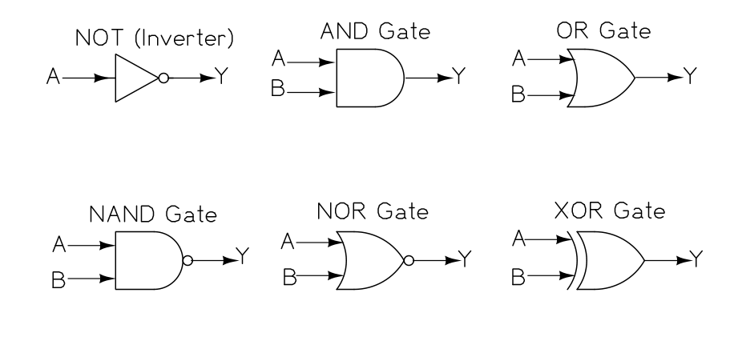
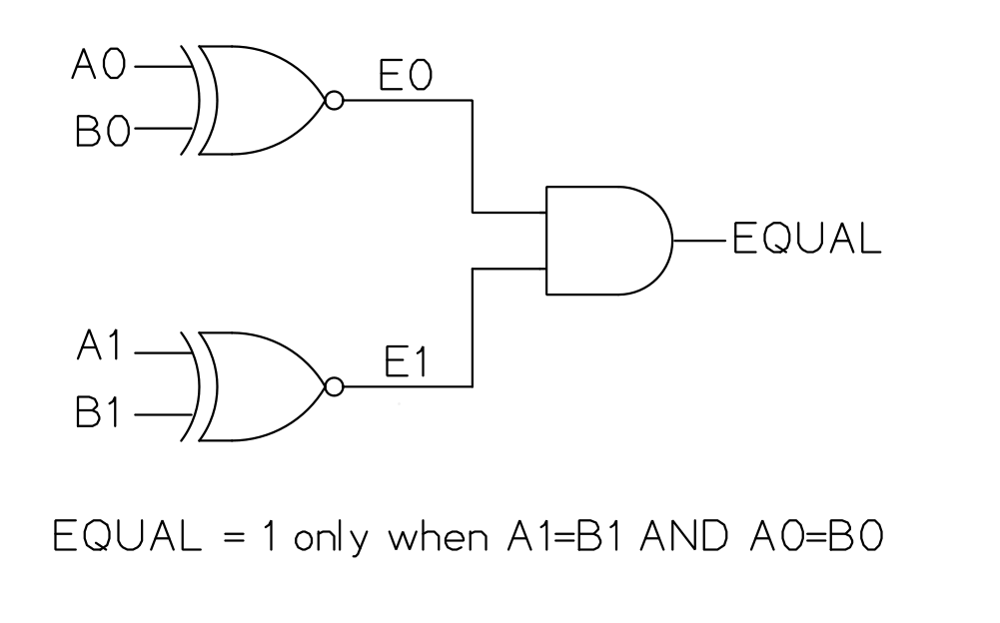
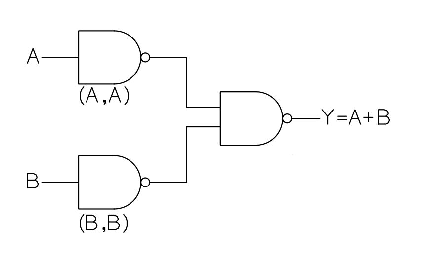

import TawkWidget from '../../../../components/TawkWidget.astro';
import UniversalContentContributors from '../../../../components/UniversalContentContributors.astro';
import InArticleAd from '../../../../components/InArticleAd.astro';
import Copyright from '../../../../components/Copyright.astro';
import BionicText from '../../../../components/BionicText.astro';
import TailwindWrapper from '../../../../components/TailwindWrapper.jsx';
import { Tabs, TabItem } from '@astrojs/starlight/components';
import { Card, CardGrid, Badge, Steps, LinkButton, FileTree } from '@astrojs/starlight/components';

<UniversalContentContributors 
  contributors={frontmatter.contributors}
/>


import DigitalElectronicsComments from '../../../../components/digital-electronics/DigitalElectronicsComments.astro';

A press must come down only when the guard is closed and both hand buttons are pressed. If the circuit that decides this is wrong in one case out of eight, someone is hurt. Logic gates make that decision, and every processor is built from the same few kinds. When you write `PORTB |= (1 << 5);` in C, OR gates inside the chip do the work. This lesson puts gates on a breadboard so you can test every case yourself. #LogicGates #BooleanAlgebra #DigitalCircuits

## The Six Fundamental Gates

A gate is a small circuit that takes one or two binary inputs and gives one binary output according to a fixed rule. Digital circuits are built from these six gate types.



*The small circle on a symbol means the signal is inverted at that point.*

### NOT Gate (Inverter)

The NOT gate has one input and one output. It inverts the input: 0 becomes 1, and 1 becomes 0.

**Truth table** (a table that lists every input combination and the output for each):

| Input A | Output Y |
|---------|----------|
| 0 | 1 |
| 1 | 0 |

**Boolean expression:** $Y = \overline{A}$ (also written as $Y = A'$ or $Y = \lnot A$)

**C equivalent:** `y = ~a;` (bitwise NOT)

**IC** (integrated circuit, a chip): 74HC04 (hex inverter, six independent NOT gates in one package)

### AND Gate

The AND gate outputs 1 only when both inputs are 1. Think of two switches in series with a lamp: both must be closed.

**Truth table:**

| Input A | Input B | Output Y |
|---------|---------|----------|
| 0 | 0 | 0 |
| 0 | 1 | 0 |
| 1 | 0 | 0 |
| 1 | 1 | 1 |

**Boolean expression:** $Y = A \cdot B$ (or simply $Y = AB$)

**C equivalent:** `y = a & b;` (bitwise AND)

**IC:** 74HC08 (quad 2-input AND, four independent AND gates)

**Embedded use:** Masking bits. `PINB & (1 << 5)` tests whether bit 5 is high by ANDing with a mask that has only bit 5 set.

### OR Gate

The OR gate outputs 1 when at least one input is 1. Think of two switches in parallel: either one lights the lamp.

**Truth table:**

| Input A | Input B | Output Y |
|---------|---------|----------|
| 0 | 0 | 0 |
| 0 | 1 | 1 |
| 1 | 0 | 1 |
| 1 | 1 | 1 |

**Boolean expression:** $Y = A + B$

**C equivalent:** `y = a | b;` (bitwise OR)

**IC:** 74HC32 (quad 2-input OR)

**Embedded use:** Setting bits. `PORTB |= (1 << 5)` sets bit 5 by ORing with a mask.

### NAND Gate

The NAND gate is an AND followed by a NOT. It outputs 0 only when both inputs are 1.

**Truth table:**

| Input A | Input B | Output Y |
|---------|---------|----------|
| 0 | 0 | 1 |
| 0 | 1 | 1 |
| 1 | 0 | 1 |
| 1 | 1 | 0 |

**Boolean expression:** $Y = \overline{A \cdot B}$

**IC:** 74HC00 (quad 2-input NAND)

NAND is called a "universal gate" because you can build any other gate from NAND gates alone.

### NOR Gate

The NOR gate is an OR followed by a NOT. It outputs 1 only when both inputs are 0.

**Truth table:**

| Input A | Input B | Output Y |
|---------|---------|----------|
| 0 | 0 | 1 |
| 0 | 1 | 0 |
| 1 | 0 | 0 |
| 1 | 1 | 0 |

**Boolean expression:** $Y = \overline{A + B}$

NOR is also a universal gate.

### XOR Gate (Exclusive OR)

The XOR gate outputs 1 when the inputs are different. A stair light with one switch at the bottom and one at the top works this way: change either switch and the light changes.

**Truth table:**

| Input A | Input B | Output Y |
|---------|---------|----------|
| 0 | 0 | 0 |
| 0 | 1 | 1 |
| 1 | 0 | 1 |
| 1 | 1 | 0 |

**Boolean expression:** $Y = A \oplus B$

**C equivalent:** `y = a ^ b;` (bitwise XOR)

**IC:** 74HC86 (quad 2-input XOR)

**Embedded use:** Toggling bits. `PORTB ^= (1 << 5)` toggles bit 5 by XORing with a mask.

XOR is also the basis of error checks such as parity and CRC, which detect a bit that changed on its way.

## 74HC Series IC Pinouts

<InArticleAd />


To wire a gate you must know which pin of the chip is which. The 74HC family works from 2V to 6V, so it suits both 3.3V and 5V systems. Its quad-gate ICs come in the same 14-pin DIP (dual in-line package), the kind that fits a breadboard.

### 74HC08 (Quad AND) Pin Layout

.png)

*1A and 1B are the inputs of gate 1, and 1Y is its output.*

- Pin 7 = GND (connect to 0V)
- Pin 14 = VCC (connect to 5V)
- Gate 1: inputs on pins 1, 2; output on pin 3
- Gate 2: inputs on pins 4, 5; output on pin 6
- Gate 3: inputs on pins 9, 10; output on pin 8
- Gate 4: inputs on pins 12, 13; output on pin 11

The 74HC00 (NAND), 74HC32 (OR), and 74HC86 (XOR) all use the same pinout. Only the gate function differs. The 74HC02 (quad NOR) is the exception: its outputs are pins 1, 4, 10 and 13.

### 74HC04 (Hex Inverter) Pin Layout

.png)

There are six inverters in one package. Each has one input (A) and one output (Y) on the next pin.

## Practical: Build and Verify Truth Tables

<InArticleAd />


### Parts Needed

| Component | Quantity |
|-----------|----------|
| Breadboard | 1 |
| 74HC08 (AND) | 1 |
| 74HC32 (OR) | 1 |
| 74HC04 (NOT) | 1 |
| LEDs (any color) | 3 |
| 220 ohm resistors | 3 |
| 10K ohm resistors | 2 |
| 100 nF capacitor | 1 |
| Push buttons | 2 |
| 5V power supply | 1 |
| Jumper wires | assorted |

### Wiring the AND Gate

<Steps>
1. **Place the 74HC08** across the center groove of the breadboard, straddling the gap.

2. **Connect power:** pin 14 to the 5V rail, pin 7 to the GND rail. Put the 100 nF capacitor from pin 14 to pin 7, close to the chip. It supplies the current pulses the gates draw when they switch.

3. **Wire input A (pin 1)** to a push button. Connect a 10K pull-down resistor from pin 1 to GND. The button connects pin 1 to 5V when pressed. When not pressed, the pull-down holds the input at 0. Without it the released input is connected to nothing: it floats, picks up noise, and reads 0 or 1 at random.

4. **Wire input B (pin 2)** the same way with a second push button and pull-down resistor. Then connect the inputs of the three gates you do not use (pins 4, 5, 9, 10, 12, 13) straight to GND. A floating input can sit halfway between 0 and 1, where the gate draws extra current and can oscillate.

5. **Wire the output (pin 3)** to an LED through a 220 ohm resistor. Connect the LED anode to pin 3 (through the resistor) and the cathode to GND.

6. **Test all four input combinations:**
   - Both buttons released: LED off (0 AND 0 = 0)
   - Button A only: LED off (1 AND 0 = 0)
   - Button B only: LED off (0 AND 1 = 0)
   - Both buttons pressed: LED on (1 AND 1 = 1)
</Steps>

### Wiring the OR Gate

Use the same circuit but replace the 74HC08 with the 74HC32. Now the LED lights when either or both buttons are pressed.

### Wiring the NOT Gate

Use the 74HC04. Connect one push button (with pull-down) to pin 1 (input). Connect pin 2 (output) to an LED with a 220 ohm resistor. Tie the five unused inputs (pins 3, 5, 9, 11, 13) to GND. The LED will be on when the button is not pressed and off when it is pressed.

:::tip[Debugging tip]
If your circuit does not work, check three things first: (1) VCC and GND are on the correct pins, (2) the IC is the right way round (the notch or dot marks the pin 1 end), (3) every input, used or not, is tied to a pull-down, a pull-up or a rail, so none floats.
:::

## Boolean Algebra

<InArticleAd />


A logic rule written down directly often uses more gates than it needs, and every gate costs space, power and delay. Boolean algebra is the set of rules that reduces a logic expression without changing what it does. In the expressions, a dot (or two letters side by side) means AND, a plus means OR, and a bar over a letter means NOT.

### Basic Laws

You can check any law by trying 0 and 1 for each letter.

| Law | AND Form | OR Form |
|-----|----------|---------|
| Identity | $A \cdot 1 = A$ | $A + 0 = A$ |
| Null | $A \cdot 0 = 0$ | $A + 1 = 1$ |
| Idempotent | $A \cdot A = A$ | $A + A = A$ |
| Complement | $A \cdot \overline{A} = 0$ | $A + \overline{A} = 1$ |
| Commutative | $A \cdot B = B \cdot A$ | $A + B = B + A$ |
| Associative | $(AB)C = A(BC)$ | $(A+B)+C = A+(B+C)$ |
| Distributive | $A(B+C) = AB + AC$ | $A + BC = (A+B)(A+C)$ |
| Absorption | $A(\overline{A} + B) = AB$ | $A + \overline{A}B = A + B$ |

### De Morgan's Theorems

These two theorems say how to move a NOT through an AND or an OR. In plain words: "not (raining and cold)" means "not raining, or not cold". The AND turns into an OR.

**Theorem 1:** $\overline{A \cdot B} = \overline{A} + \overline{B}$

The complement (the NOT) of an AND equals the OR of the complements. A NAND gate does the same as an OR gate with both inputs inverted.

**Theorem 2:** $\overline{A + B} = \overline{A} \cdot \overline{B}$

The complement of an OR equals the AND of the complements. A NOR gate does the same as an AND gate with both inputs inverted.

**In C code, De Morgan's theorems look like this:**

```c
// These two expressions are equivalent:
!(a && b)    ==    (!a || !b)

// These two expressions are equivalent:
!(a || b)    ==    (!a && !b)

// For bitwise operations:
~(a & b)     ==    (~a | ~b)
~(a | b)     ==    (~a & ~b)
```

### Simplification Example

Simplify: $Y = A\overline{B} + AB$

<Steps>
1. Factor out $A$: $Y = A(\overline{B} + B)$
2. Apply the complement law ($\overline{B} + B = 1$): $Y = A \cdot 1$
3. Apply the identity law: $Y = A$
</Steps>

The output depends only on $A$. In a circuit, you could remove the $B$ input and every gate.

### Another Example

Simplify: $Y = \overline{A}B + A\overline{B} + AB$

<Steps>
1. Group the last two terms: $Y = \overline{A}B + A(\overline{B} + B)$
2. Simplify: $Y = \overline{A}B + A$
3. Apply the absorption law ($A + \overline{A}B = A + B$): $Y = A + B$
</Steps>

The three terms reduce to one OR. In hardware, two NOT gates, three AND gates and two OR gates become a single OR gate.

### Karnaugh Maps (K-maps)

With three or four variables, algebra is slow. A Karnaugh map does the same work by eye. It is the truth table drawn as a grid in which neighbouring cells differ in only one variable, so a group of neighbouring 1s shows a variable that does not matter.

**Two-variable K-map for $Y = \overline{A}B + A\overline{B} + AB$:**

|  | B=0 | B=1 |
|--|-----|-----|
| **A=0** | 0 | 1 |
| **A=1** | 1 | 1 |

Group the two cells in the A=1 row (giving $A$) and the two cells in the B=1 column (giving $B$). The simplified expression is $Y = A + B$.

A three-variable map has two rows (A) and four columns (BC). The columns are in Gray code order (00, 01, 11, 10), in which only one variable changes from one column to the next. Group the 1s in rectangular blocks of 1, 2, 4, or 8 cells. The larger the block, the simpler the term.

## Multi-Gate Combination Example

<InArticleAd />


A practical circuit often chains several gate types. Here is a 2-bit equality comparator that outputs 1 when the number A1A0 equals the number B1B0. It uses XNOR, which is XOR followed by NOT: XNOR outputs 1 when its two inputs match.



Each XNOR checks one pair of bits, and the AND gate asks that both pairs match. An 8-bit comparator uses 8 XNOR gates and an 8-input AND.

The press from the opening is a 3-input AND, $Y = G \cdot L \cdot R$ (guard closed, left and right buttons pressed). Only one of the $2^3 = 8$ cases gives $Y = 1$. Build it from two gates of the 74HC08: G and L into gate 1, then pin 3 and R into gate 2 (pins 4 and 5). **Check it:** step through all eight cases against the truth table; right in seven is a fail. A real press never uses plain gates for this, because a gate can fail with its output stuck at 1. It uses a two-channel safety relay or safety controller.

## NAND as a Universal Gate

<InArticleAd />


Any logic function can be built from NAND gates alone, so a box of 74HC00 chips can build any digital circuit. This matters because making one type of gate is simpler and cheaper. Here is how to build each basic gate from NAND:

**NOT from NAND:** Connect both inputs of a NAND gate together. With both inputs equal to A, the output is 1 for A = 0 and 0 for A = 1.

**AND from NAND:** Use two NAND gates. The first performs NAND, the second inverts the result.

$$Y = \overline{\overline{A \cdot B}} = A \cdot B$$

**OR from NAND:** Use three NAND gates. First invert both inputs (two NANDs with tied inputs), then NAND the results.

By De Morgan's theorem: $\overline{\overline{A} \cdot \overline{B}} = A + B$



## Practical: Build a NAND-Only OR Gate

<InArticleAd />


<Steps>
1. **Use a single 74HC00** (quad NAND) IC on your breadboard.

2. **Gate 1 (inverter for A):** Connect your first push button (with pull-down) to both pins 1 and 2. The output on pin 3 is $\overline{A}$.

3. **Gate 2 (inverter for B):** Connect your second push button (with pull-down) to both pins 4 and 5. The output on pin 6 is $\overline{B}$.

4. **Gate 3 (NAND of inverted inputs):** Connect pin 3 to pin 9, pin 6 to pin 10. The output on pin 8 is $\overline{\overline{A} \cdot \overline{B}} = A + B$.

5. **Connect pin 8** to an LED through a 220 ohm resistor. Tie pins 12 and 13, the inputs of the unused fourth gate, to GND.

6. **Verify:** The LED behaves as an OR gate. It lights when either or both buttons are pressed.
</Steps>

## Gate Propagation Delay

<InArticleAd />


Real gates do not switch at once. The output of a 74HC08 AND gate responds about 7 nanoseconds (ns) after its input changes, at 5V. This time is the propagation delay.

In a chain of gates the delays add. Five gates in a row take about $5 \times 7 = 35$ ns. If a new input arrives before the old answer has come out, the answer is wrong. So the longest chain of gates sets the highest clock speed of a circuit, and of a microcontroller.

The 7 ns is typical. Design with the data sheet maximum, about 15 ns per gate at 25 °C and more when hot: five gates then take up to $5 \times 15 = 75$ ns. A circuit timed on typical values can pass on the bench and fail in a hot cabinet.

| Parameter | 74HC Series (5V) | 74HCT Series (5V) |
|-----------|------------------|-------------------|
| Propagation delay | ~7 ns | ~10 ns |
| Maximum frequency | ~40 MHz | ~25 MHz |
| Operating voltage | 2V to 6V | 4.5V to 5.5V |

The 74HCT series accepts the input levels of TTL, an older logic family.

## Exercises

<InArticleAd />


### Exercise 1: Truth Table Completion

Complete the truth table for $Y = A \cdot \overline{B} + \overline{A} \cdot B$ (this is XOR):

| A | B | $\overline{A}$ | $\overline{B}$ | $A \cdot \overline{B}$ | $\overline{A} \cdot B$ | Y |
|---|---|---|---|---|---|---|
| 0 | 0 | ? | ? | ? | ? | ? |
| 0 | 1 | ? | ? | ? | ? | ? |
| 1 | 0 | ? | ? | ? | ? | ? |
| 1 | 1 | ? | ? | ? | ? | ? |

<details>
<summary>**Solution**</summary>

| A | B | $\overline{A}$ | $\overline{B}$ | $A \cdot \overline{B}$ | $\overline{A} \cdot B$ | Y |
|---|---|---|---|---|---|---|
| 0 | 0 | 1 | 1 | 0 | 0 | 0 |
| 0 | 1 | 1 | 0 | 0 | 1 | 1 |
| 1 | 0 | 0 | 1 | 1 | 0 | 1 |
| 1 | 1 | 0 | 0 | 0 | 0 | 0 |

This confirms the XOR truth table.

</details>

### Exercise 2: Boolean Simplification

Simplify: $Y = ABC + AB\overline{C} + A\overline{B}C$

<details>
<summary>**Solution**</summary>

1. Group first two terms: $Y = AB(C + \overline{C}) + A\overline{B}C$
2. Simplify: $Y = AB + A\overline{B}C$
3. Factor out $A$: $Y = A(B + \overline{B}C)$
4. Apply the absorption law ($B + \overline{B}C = B + C$): $Y = A(B + C)$
5. Expand if needed: $Y = AB + AC$

</details>

### Exercise 3: Apply De Morgan's Theorem

Rewrite using only AND and NOT operations: $Y = \overline{A + B + C}$

<details>
<summary>**Solution**</summary>

Apply De Morgan's theorem: $Y = \overline{A} \cdot \overline{B} \cdot \overline{C}$

In C: `y = ~a & ~b & ~c;`

</details>

## How This Connects to Embedded Programming

<InArticleAd />


<CardGrid>
  <Card title="Bitwise Operators ARE Logic Gates" icon="setting">
    When you write `PORTB & 0x0F` in C, the processor sends each pair of bits through a physical AND gate. The truth tables you tested with LEDs are the ones the chip uses.
  </Card>

  <Card title="Register Bit Masking" icon="open-book">
    Setting, clearing and toggling register bits is Boolean algebra on hardware. `REG |= mask` is OR. `REG &= ~mask` is AND with NOT. `REG ^= mask` is XOR.
  </Card>

  <Card title="Conditional Logic in Hardware" icon="approve-check">
    Inside the microcontroller (MCU), circuits made of AND, OR and NAND gates route signals and switch on the part that an address names. It is the logic you built on the breadboard, only much smaller.
  </Card>

  <Card title="De Morgan's in Optimization" icon="rocket">
    With De Morgan's theorems you can rewrite a condition in the form that is easiest to read, and see when two conditions are the same.
  </Card>
</CardGrid>

## Summary

<InArticleAd />


| Concept | Key Takeaway |
|---------|-------------|
| NOT, AND, OR | The three fundamental operations. All others derive from these. |
| NAND, NOR | Universal gates. Either one alone can build any logic circuit. |
| XOR | Outputs 1 when inputs differ. Used for toggling, parity, CRC. |
| De Morgan's theorems | $\overline{AB} = \overline{A} + \overline{B}$ and $\overline{A+B} = \overline{A} \cdot \overline{B}$. Essential for simplification. |
| Boolean simplification | Reduces gate count, which reduces cost, power, and propagation delay. |
| 74HC series ICs | Real, physical gates you can wire on a breadboard to verify truth tables. |

<DigitalElectronicsComments />


<InArticleAd />
<TawkWidget />
<Copyright />
